<p align="center">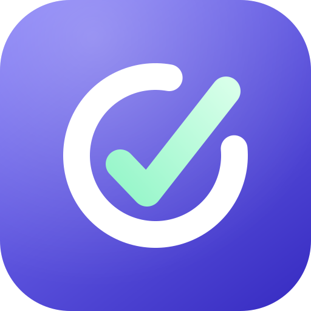</p>

<h1 align="center">Tickly</h1>
<p align="center"><b>Zeiterfassung, die man nicht bedienen muss.</b><br>
Eine kleine App auf Windows und macOS erkennt Arbeitsbeginn, Sperre, Pausen und aktive Programme – ein selbst gehosteter Server rechnet daraus Arbeitszeit, Überstunden und Statistiken.</p>

<p align="center">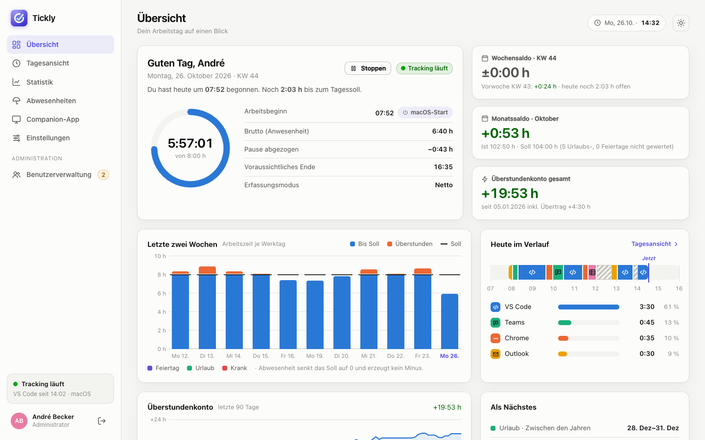</p>

> **Stand: Version 0.9.11.** Server, Weboberfläche und macOS-Companion sind getestet.
> Der **Windows-Teil der Companion-App ist geschrieben und wird in der CI übersetzt, wurde aber noch nicht auf einem echten Windows-Rechner ausgeführt**. Mehr unter [Bekannte Grenzen](#bekannte-grenzen).

## Was Tickly kann

**Erfassen**
- Der **Companion** startet mit dem Rechner und merkt sich den Arbeitsbeginn. Sperre und Ruhezustand erscheinen im Zeitverlauf, die **aktive App** wird mit Dauer festgehalten (nie Fenstertitel).
- **Neustart ohne Datenverlust:** Lief das Tracking, geht es nach einem Neustart oder Absturz von selbst weiter. Ein **richtiges Beenden** der App stoppt das Tracking und setzt das Arbeitsende.
- **Auch ohne Verbindung** (Zug, Kunde ohne WLAN): Der Companion rechnet lokal mit und überträgt alles später, mit den echten Zeitpunkten.
- **Zeitfenster** je Wochentag starten das Tracking automatisch; außerhalb fragt der Companion „Arbeitest du gerade?“. Pausieren und Fortsetzen geht im Companion, Beenden in der Weboberfläche; den automatischen Start schaltest du je Gerät ab.
- **Nachträglich korrigieren** und **manuell ergänzen** (z. B. ein Termin ohne Rechner), mit Protokoll und einstellbarem Zeitraum.

**Rechnen**
- Soll je Wochentag, **Brutto oder Netto** mit automatischem Pausenabzug (z. B. 30 Min. ab 6 h, 45 Min. ab 9 h; echte Pausen durch Sperre zählen, wenn sie länger sind).
- **Feiertage je Bundesland**, Urlaub, Krankheit, Zeitausgleich und eigene freie Tage (Rosenmontag, Heiligabend …) – sie **verfälschen die Überstunden nicht**.
- Überstunden pro Woche, Monat und insgesamt, Prognose für das Tagesende, Übertrag bei der Registrierung.

**Auswerten** – Tagesansicht mit Zeitverlauf und Programmwechseln, Wochen-, Monats- und Jahresstatistik, App-Rangliste mit Symbolen, CSV-Export, Hell/Dunkel/System.

**Verwalten** – Benutzer mit offener oder per Einladung geschlossener Registrierung und Freigabe, **Passkeys**, **Authenticator-App (TOTP)** und optional **Pflicht zu MFA mit Karenzzeit**, **Passwort selbst zurücksetzen** (Mail-Link oder Sicherheitsfragen) und **Initialpasswort durch Administratoren** mit erzwungener Änderung; **Zeiterfassung auch rein im Web** (Start, Beenden mit Vorschau von Brutto/Netto, eigenes Ende, Mail bei über 10 Stunden), Sitzungen und Geräte mit **IP und Land** (beendbar), **Protokoll**, **automatische IP-Sperre** nach Fehlversuchen (auch hinter Cloudflare mit echter Besucher-IP), **SMTP per Oberfläche** (E-Mail-Bestätigung, Passwort zurücksetzen, Einladungen, Hinweise), **Sicherung und Wiederherstellung** mit Zeitplan, getrenntem Verzeichnis und Verschlüsselung.

## Ansichten

| | |
|---|---|
| 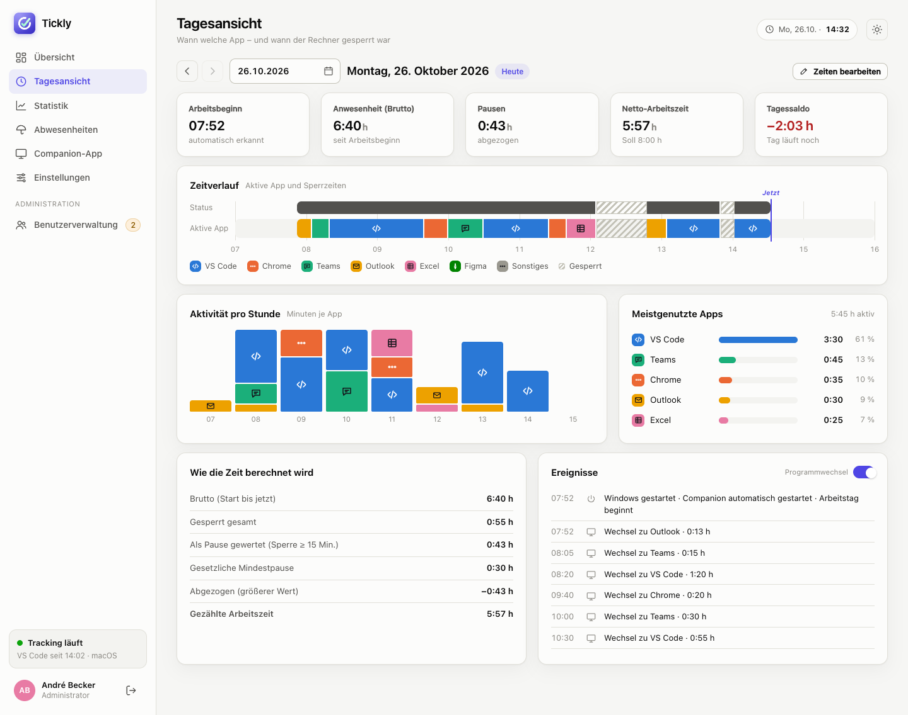 | 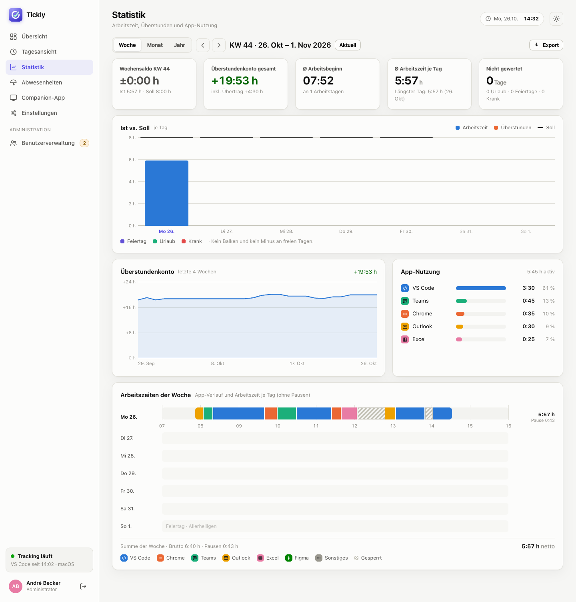 |
| **Tagesansicht** – App-Verlauf, Sperrzeiten, Ereignisse | **Wochenstatistik** – Arbeitszeit ohne Pausen je Tag |
| 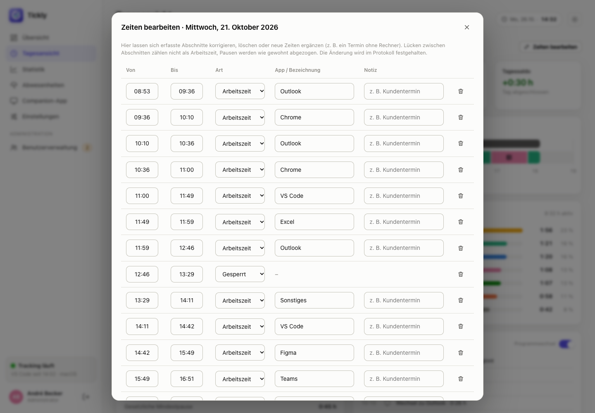 | 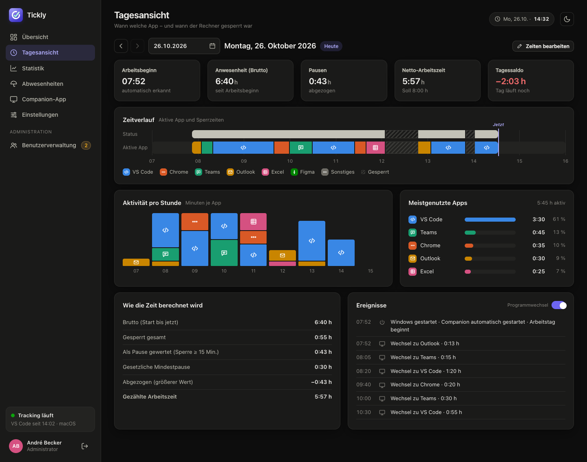 |
| **Zeiten bearbeiten** und manuell ergänzen | **Dunkelmodus** (oder System) |
| 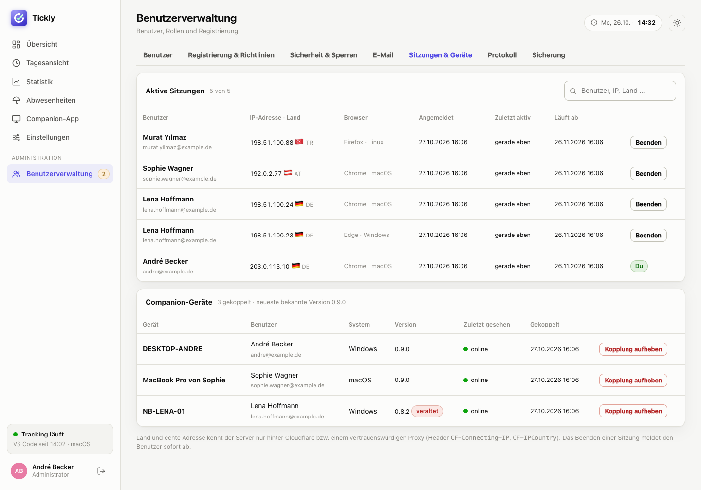 | 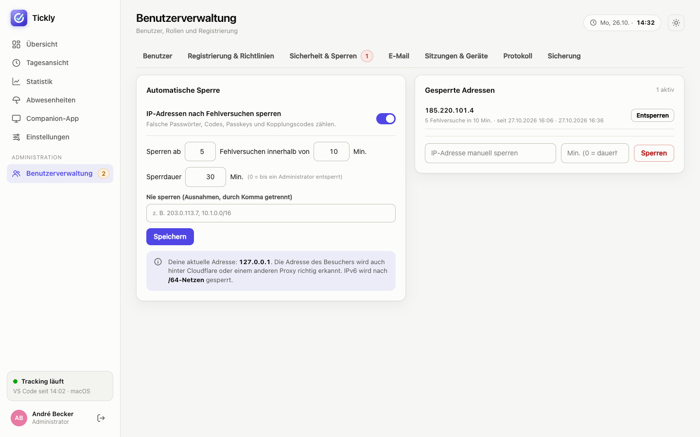 |
| **Sitzungen & Geräte** mit IP, Land und veralteten Versionen | **IP-Sperren** und Einstellungen |
| 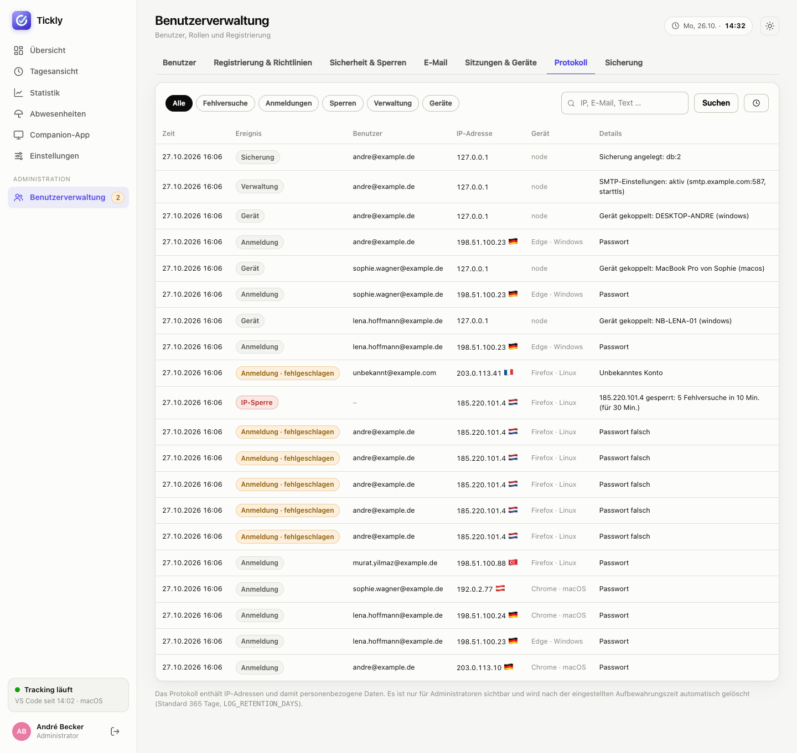 | 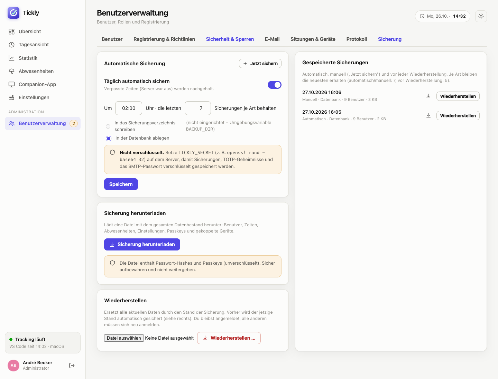 |
| **Protokoll** mit Original-IP | **Sicherung** mit Zeitplan und Verschlüsselung |

Die **Companion-App** (Tray/Menüleiste und kleines Fenster):

<p>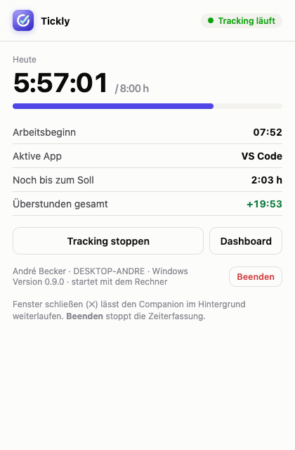 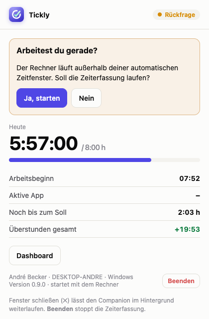 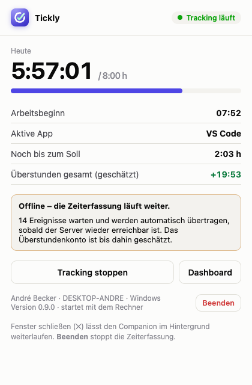 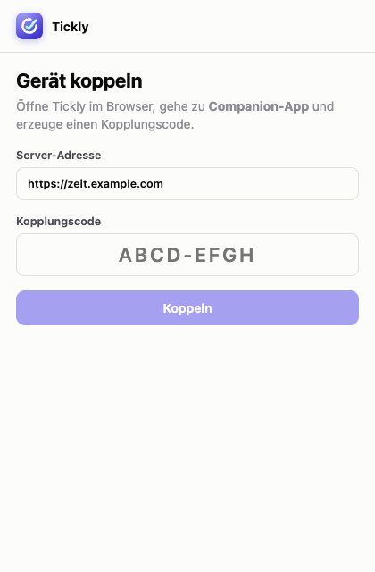</p>

Alle Bilder: [docs/screenshots](docs/screenshots). Sie stammen aus der Demo und lassen sich mit `scripts/screenshots.mjs` neu erzeugen.

## Schnellstart

**Ausprobieren (Demo, ohne Docker):** Rust und PostgreSQL-Programme installieren (`brew install postgresql@17`), dann

```sh
git clone <dieses Repository> tickly && cd tickly
scripts/dev.sh                # http://localhost:3000 · andre@example.de / demo-passwort
```

Die Demo hat ein festes Datum, einen Zeitraffer und erzeugte Beispieldaten (Administrator `andre@example.de`, Benutzer `lena.hoffmann@example.de`, Passwort `demo-passwort`).

**Betrieb mit Docker** (API + PostgreSQL; öffentlich hinter einem Proxy deiner Wahl, z. B. Zoraxy oder Cloudflare):

```sh
cp .env.example .env          # PUBLIC_URL, DB_PASSWORD, TICKLY_SECRET ausfüllen (Befehle zum Erzeugen stehen in der Datei)
docker compose up -d --build  # lokal auf http://localhost:3000
docker compose logs api       # zeigt den Einrichtungscode; dann http://localhost:3000 öffnen und den Administrator anlegen
```

Ausführlich: **[Installation](docs/INSTALLATION.md)**. Die Companion-App installierst du aus den Release-Dateien: **[Companion-App](docs/COMPANION.md)**.

## Dokumentation

| Für wen | Dokument |
|---|---|
| Betreiber | [Installation und Betrieb](docs/INSTALLATION.md) · [Administration](docs/ADMINISTRATION.md) · [Sicherheit und Datenschutz](docs/SICHERHEIT.md) |
| Benutzer | [Benutzerhandbuch](docs/BENUTZERHANDBUCH.md) · [Companion-App](docs/COMPANION.md) |
| Entwickler | [Architektur und API](docs/ARCHITEKTUR.md) · [Entwicklung und Release](docs/ENTWICKLUNG.md) · [Änderungen](CHANGELOG.md) |

## Aufbau

```
Companion (Windows/macOS) ──HTTPS──▶ Proxy (Zoraxy, Cloudflare …) ──▶ api (Axum) ──▶ PostgreSQL
Browser                   ──HTTPS──▶                                  └──▶ tickly-core (Rechenlogik)
```

| Ordner | Inhalt |
|---|---|
| `crates/core` | Rust: Rechenlogik ohne Ein-/Ausgabe (Soll/Ist, Pausen, Feiertage, Salden, Tageszustand) – gemeinsam für Server und Companion |
| `apps/api` | Rust (Axum, SQLx): HTTP-API, Anmeldung, Administration; liefert die Weboberfläche aus |
| `crates/agent`, `crates/platform` | Rust: Tracking-Kern des Companion; Systemzugriff (aktive App, Sperre, Herunterfahren) |
| `apps/companion` | Tauri 2 + React: die Companion-App |
| `web/` | Weboberfläche (Vanilla-JS, ohne Build-Schritt) |
| `docs/`, `scripts/` | Dokumentation, Screenshots; Entwicklungs- und Hilfsskripte |

## Bekannte Grenzen

- **Windows-Companion nicht auf Windows getestet** (aktive App, Sperrerkennung, Herunterfahren). Bitte vor dem Einsatz auf einem echten Rechner prüfen und Fehler melden.
- **Installer sind nicht signiert** – Windows (SmartScreen) und macOS (Gatekeeper) warnen beim ersten Start. Für den Einsatz im Team Zertifikat bzw. Apple-Developer-ID einrichten.
- **Docker:** Image und Compose-Datei sind auf einem Apple-Silicon-Mac (Colima, linux/arm64) gebaut und gestartet worden: Einrichtung, Origin-Prüfung, Healthcheck und Sicherung ins Volume funktionieren. Das Image für linux/amd64 wird mitgebaut, aber nicht auf einem amd64-Rechner gestartet. Windows (Installer) und die Verbindung zu einem echten Proxy wie Zoraxy sind nicht getestet.
- Die Inaktivitätserkennung („Leerlauf“) ist als Einstellung vorhanden, wird aber noch nicht ausgewertet; Fenstertitel werden nie erfasst.
- Die Weboberfläche ist Vanilla-JS; eine Umstellung auf React ist geplant.
- Die Statistik rechnet bei jedem Aufruf alle Tage neu – gedacht für Teams und Abteilungen, nicht für tausende Benutzer.

## Sicherheitslücken

Bitte vertraulich an **vuln@4reg.de** melden (kein öffentliches Issue), siehe [SECURITY.md](SECURITY.md).

## Lizenz

[MIT](LICENSE) – frei nutzbar, veränderbar und weitergebbar, auch kommerziell. Beiträge sind willkommen (siehe [Entwicklung](docs/ENTWICKLUNG.md)).
