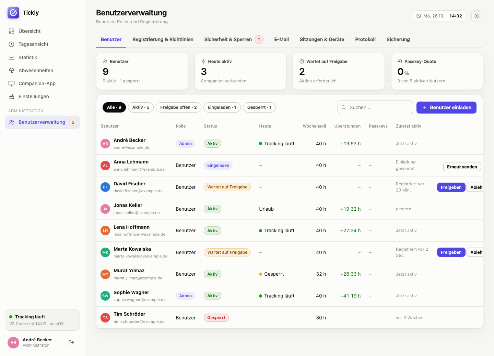
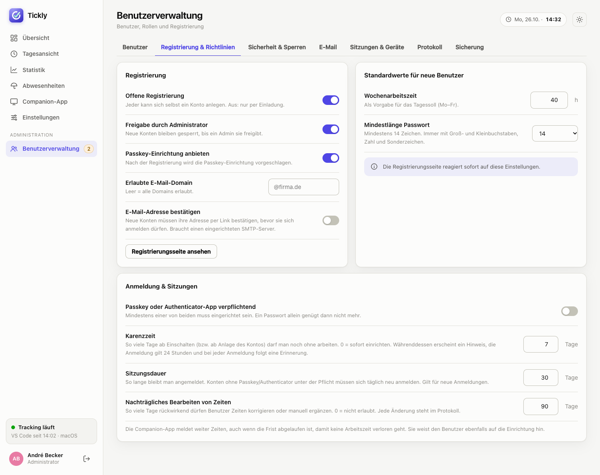
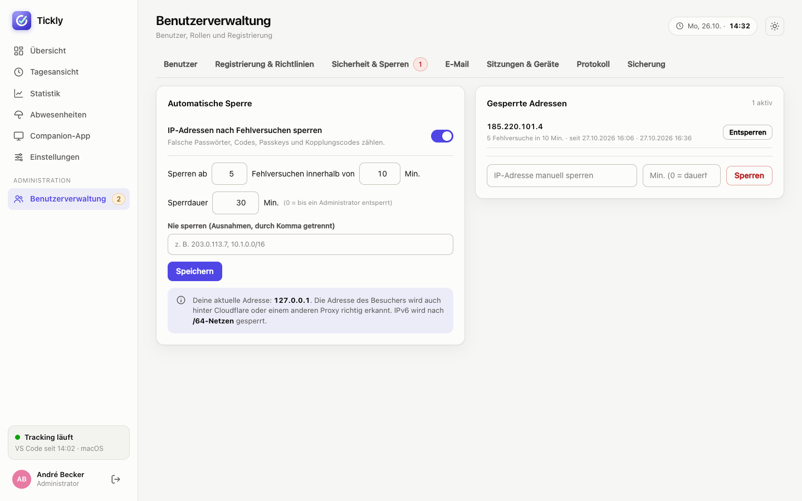
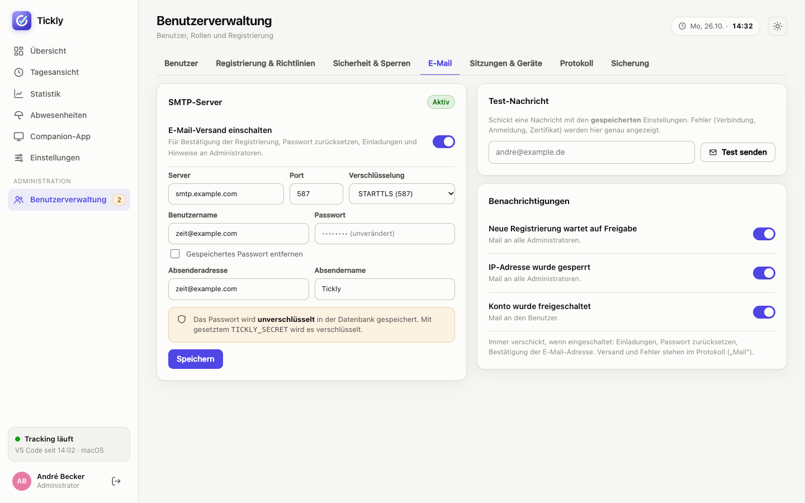
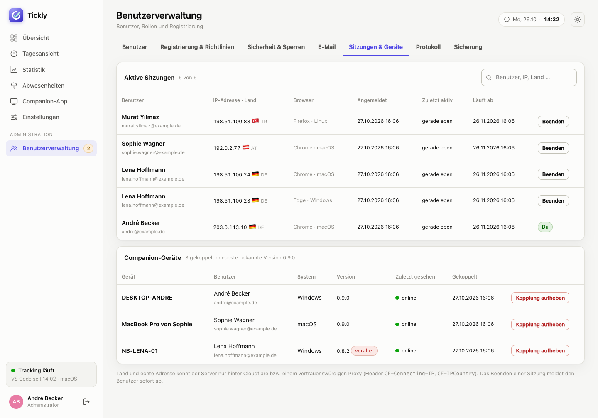
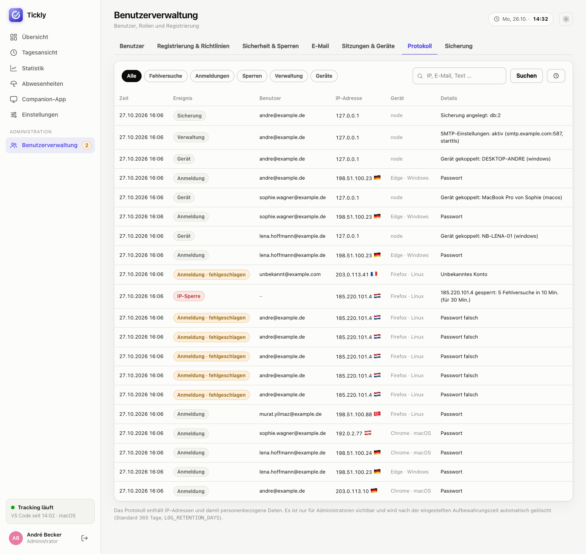
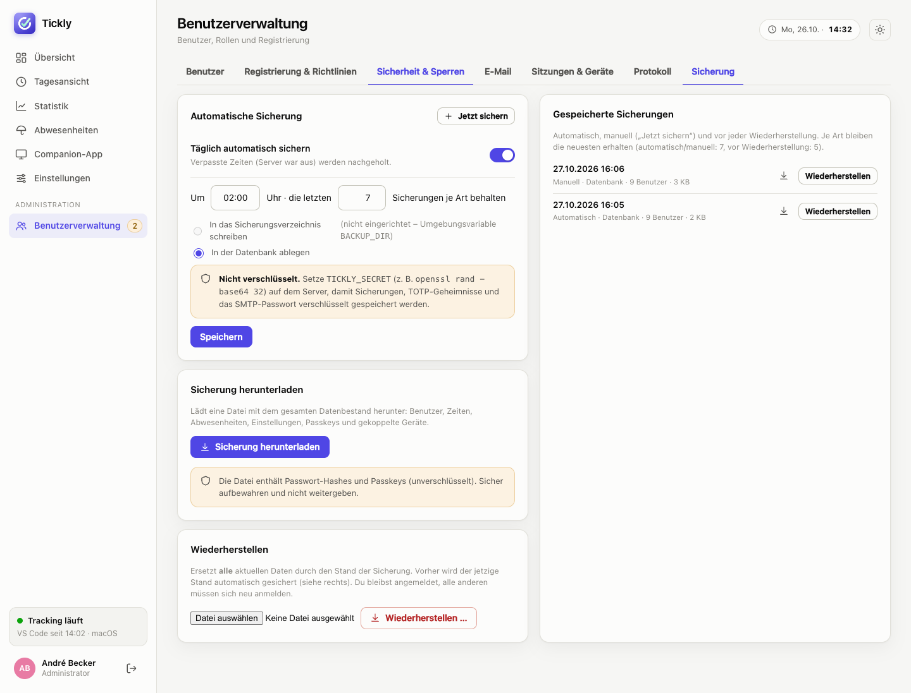

# Administration

Administratoren sehen in der Seitenleiste **Benutzerverwaltung** mit diesen Reitern.

## Benutzer

Liste mit Status (aktiv, wartet auf Freigabe, eingeladen, gesperrt), Rolle, heutigem Tracking, Wochensoll, Überstunden, Passkeys/TOTP und letzter Aktivität.

- **Einladen:** Name, E-Mail, Rolle, Wochensoll. Mit eingerichtetem SMTP bekommt die Person eine Mail; sonst legst du nur das Konto an und gibst den Link selbst weiter.
- **Direkt mit Initialpasswort anlegen:** Statt der Einladung legst du das Konto sofort aktiv an (ohne E-Mail-Bestätigung). Das Initialpasswort wählst du selbst oder lässt es erzeugen; es wird einmal angezeigt. Beim **ersten Anmelden** muss der Benutzer ein eigenes Passwort festlegen und, wenn das Zurücksetzen per Sicherheitsfragen eingeschaltet ist, **seine Sicherheitsfragen nachtragen**. Dasselbe gilt für jedes Konto, bei dem du ein Initialpasswort setzt und das noch keine Fragen hat.
- **Bearbeiten:** Name, E-Mail, Rolle, Wochensoll, **Überstunden-Übertrag** (nur hier änderbar), Passkeys oder TOTP zurücksetzen, **alle Sitzungen beenden**, löschen.
- **Neues Passwort setzen:** Du vergibst ein **Initialpasswort** (leer lassen = der Server erzeugt ein langes, zufälliges). Es wird nur einmal angezeigt, gib es sicher weiter. Der Benutzer wird überall abgemeldet und muss beim **nächsten Anmelden mit Passwort** ein eigenes festlegen; bis dahin ist alles gesperrt. Der Benutzer bekommt (mit SMTP) eine Hinweis-Mail ohne Passwort. Ein zweiter Faktor (TOTP, Passkey) bleibt unverändert. Für das eigene Konto nutzt du *Einstellungen → Passwort ändern*.
- **Freigabe:** Neue Registrierungen (bei eingeschalteter Freigabe) bestätigst oder lehnst du ab.
- Der Hinweis „ohne MFA“ erscheint, wenn MFA verpflichtend ist und ein Konto noch nichts eingerichtet hat (rot nach Ablauf der Karenzzeit).

## Registrierung & Richtlinien

- **Warnung bei langem Tracking** (Standard 10 Stunden, 0 = aus): Läuft das Tracking eines Benutzers so viele Stunden (Brutto), sieht er einen Hinweis mit Beenden-Knöpfen auf der Übersicht und bekommt (mit SMTP) eine Mail, höchstens einmal am Tag. Besonders nützlich für Benutzer ohne Companion.
- **Zurücksetzen per Sicherheitsfragen** (Standard: an): Neue Konten mit Passwort wählen bei der Registrierung drei Fragen und können ihr Passwort damit selbst zurücksetzen. Das ist **schwächer** als ein Link per Mail, weil sich Antworten erraten lassen; schalte es aus, wenn du das nicht möchtest. Schutz: alle drei Antworten müssen stimmen, fünf Fehlversuche pro Konto und Stunde sperren diesen Weg, Fehlversuche zählen für die IP-Sperre, ein zweiter Faktor wird nie umgangen, und der Benutzer bekommt eine Mail.

| Einstellung | Wirkung |
|---|---|
| Offene Registrierung | Aus: nur per Einladung. |
| Freigabe durch Administrator | Neue Konten bleiben gesperrt, bis sie jemand freischaltet. |
| E-Mail-Adresse bestätigen | Neue Konten müssen ihre Adresse per Link bestätigen (braucht SMTP). Gilt nur für Konten, die danach entstehen. |
| Erlaubte E-Mail-Domain | z. B. `@firma.de`; leer = alle. |
| Mindestlänge Passwort | 14–24 Zeichen; immer mit Groß-/Kleinbuchstaben, Zahl und Sonderzeichen. |
| **Passkey oder Authenticator-App verpflichtend** | Mindestens einer muss eingerichtet sein. Ein Passwort allein genügt dann nicht mehr. |
| Karenzzeit | Tage (0–365, Standard 7), die man noch ohne arbeiten darf. Währenddessen: Hinweis, Erinnerung bei jeder Anmeldung, Sitzung nur **24 Stunden**. Danach nur noch die Seite „Konto absichern“. |
| Sitzungsdauer | 1–365 Tage (Standard 30) für alle mit MFA bzw. ohne Pflicht. |
| Nachträgliches Bearbeiten | Wie viele Tage rückwirkend Zeiten korrigiert/ergänzt werden dürfen (0 = nicht erlaubt). |

Die Karenzzeit beginnt beim Einschalten der Pflicht (bei neuen Konten mit der Freischaltung). Erneutes Speichern setzt sie nicht zurück. Die Companion-App meldet auch nach Ablauf weiter Zeiten, damit keine Arbeitszeit verloren geht. Hat ein Benutzer Handy und Wiederherstellungscodes verloren, setzt du TOTP in der Benutzerliste zurück.

## Sicherheit & Sperren

Zu viele Fehlversuche (falsches Passwort oder Code, abgelehnter Passkey, ungültiger Kopplungscode) von **einer Adresse** sperren diese automatisch. Standard: **5 Fehlversuche in 10 Minuten → 30 Minuten gesperrt**.

- Einstellbar: Anzahl, Zeitfenster, Sperrdauer (0 = bis zur Entsperrung) und **Ausnahmen** (Adressen/Netze, die nie gesperrt werden, z. B. das Büro).
- **Entsperren** mit einem Klick; die bisherigen Fehlversuche zählen danach nicht mehr. Adressen lassen sich auch **manuell sperren** (nicht die eigene).
- Die Sperre gilt für Anmeldung, Registrierung, zweiten Faktor, Passkey, Passwort-Zurücksetzen und Gerätekopplung. Bestehende Sitzungen und laufende Companions bleiben unberührt. IPv6 wird nach /64-Netzen gesperrt.
- Mit SMTP erhalten Administratoren eine Mail bei jeder Sperre (abschaltbar).
- Hinter einem Gemeinschaftsanschluss (Firma) trifft die Sperre alle dahinter – trage dann das Netz als Ausnahme ein.

## E-Mail (SMTP)

Server, Port, Verschlüsselung (STARTTLS/TLS/keine), Zugangsdaten und Absender, dazu eine **Test-Nachricht** mit genauer Fehlermeldung. Das Passwort wird (mit `TICKLY_SECRET`) verschlüsselt gespeichert und nie wieder angezeigt.

Verwendet für: Bestätigung der E-Mail-Adresse, Passwort zurücksetzen, Einladungen, Hinweis „Tracking läuft schon sehr lange“, Hinweis „neue Registrierung wartet“, „Konto freigeschaltet“ und „IP gesperrt“ (die letzten drei abschaltbar). Versand und Fehler stehen im Protokoll („Mail“). Es gibt keine Warteschlange: Schlägt der Versand fehl, wird er nicht wiederholt.

## Sitzungen & Geräte

Alle aktiven **Sitzungen** mit Benutzer, **IP-Adresse und Land** (Flagge), Browser, Anmeldezeit und letzter Aktivität – jede lässt sich **beenden** (der Benutzer ist sofort abgemeldet). Darunter alle **Companion-Geräte** mit System, **Version** (Hinweis „veraltet“, wenn eine neuere Version im Einsatz oder per `COMPANION_LATEST_VERSION` bekannt ist), letztem Kontakt und der Möglichkeit, die Kopplung aufzuheben. Land und echte Adresse kennt der Server hinter Cloudflare (`CF-Connecting-IP`, `CF-IPCountry`).

## Protokoll

Anmeldungen, Fehlversuche, Registrierungen, Passwort-Zurücksetzen, Geräte, Sperren/Entsperren, Verwaltungsaktionen, nachträgliche Zeitänderungen, Sicherungen und Mails – mit Zeit, Benutzer, **Original-IP** (und Land), Browser und Details. Filter, Suche, Klick auf eine IP filtert nach ihr. Einträge werden nach `LOG_RETENTION_DAYS` (Standard 365) gelöscht. IP-Adressen sind personenbezogene Daten: nur Administratoren sehen sie.

## Sicherung

- **Automatisch:** täglich zur eingestellten **Uhrzeit**, die letzten *n* Sicherungen bleiben (je Art). Verpasste Zeiten (Server war aus) werden nachgeholt.
- **Ziel:** das **Sicherungsverzeichnis** (`BACKUP_DIR`, im Compose-Betrieb `/backups` – am besten ein anderes Laufwerk) oder die Datenbank. Die Oberfläche prüft, ob das Verzeichnis beschreibbar ist.
- **Jetzt sichern**, **Herunterladen**, **Wiederherstellen** (Datei hochladen oder gespeicherte wählen).
- **Verschlüsselt** (AES-256-GCM), wenn `TICKLY_SECRET` gesetzt ist – Dateien und Datenbankeinträge. Ohne den Schlüssel sind sie unlesbar; bewahre ihn getrennt von den Sicherungen auf.
- Beim Wiederherstellen wird **alles ersetzt**, der jetzige Stand vorher gesichert, du bleibst angemeldet, sofern dein Konto in der Sicherung enthalten ist (sonst meldest du dich mit einem Konto aus der Sicherung neu an, siehe [Neuaufbau](INSTALLATION.md#neuaufbau-nach-einem-totalausfall)). Eine Sicherung ohne aktiven Administrator wird abgelehnt. Sicherungen aus älteren Versionen lassen sich einspielen.
- Nicht enthalten: Sitzungen, Kopplungscodes, E-Mail-Links, das Protokoll und die Sperrliste.

## Companion-Geräte koppeln

Unter **Companion-App** erzeugt jeder Benutzer seinen Kopplungscode selbst. Als Administrator kannst du Kopplungen unter *Sitzungen & Geräte* aufheben.
