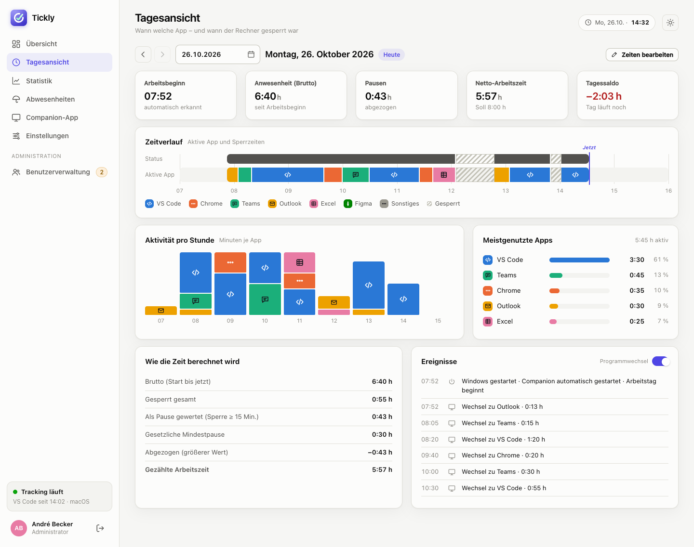
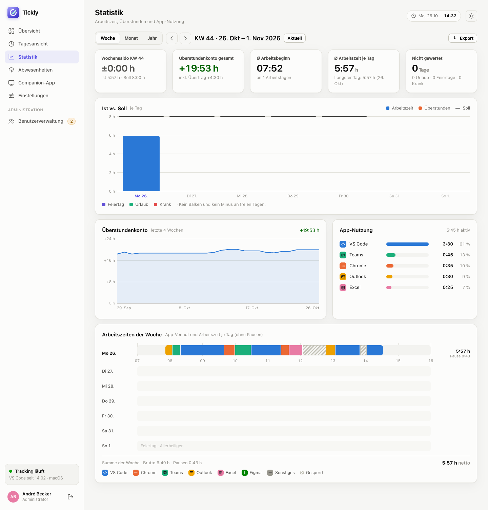

# Benutzerhandbuch

## Anmelden und Konto

- **Überstunden-Stand zu Beginn:** Nach der ersten Anmeldung fragt Tickly einmal nach deinem Stand (Guthaben positiv, Minusstunden negativ; hast du keine, wähle „Keine Überstunden“ = 0). Das legst du **einmalig** selbst fest, danach kann es nur noch ein Administrator ändern. Bis dahin erinnert ein Hinweis auf der Übersicht, und unter *Einstellungen → Profil* kannst du es nachholen.
- **Zeiterfassung ab (Startdatum):** Tickly rechnet Arbeitszeit und Überstundenkonto ab dem Tag, an dem dein Konto angelegt wurde. Probierst du erst aus und hast Testtage nicht vollständig aufgezeichnet, entstünden dort Minusstunden. Setze dann unter *Einstellungen → Profil → Zeiterfassung ab* mit **Ändern** das Datum auf den ersten Tag, ab dem es ernst ist. Tage davor zählen nicht mehr (kein Soll, kein Minus); ihre Zeiten bleiben gespeichert, lassen sich aber nicht bearbeiten, und zählen wieder mit, wenn du das Datum früher setzt. Der Überstunden-Übertrag gilt ab dem Startdatum. Das Datum darf bis zu ein Jahr in der Zukunft liegen. Im Demo-Modus ist das nicht möglich.
- **Registrieren** (wenn der Administrator es erlaubt): Name, E-Mail, Passwort – und dein **Überstunden-Stand zu Beginn**: *Neu beginnen* (0 Stunden) oder ein **Übertrag** (z. B. `12,5` Guthaben oder `−3` Minusstunden). Danach nur noch durch einen Administrator änderbar. Je nach Einstellung musst du deine **E-Mail-Adresse bestätigen** (Link in der Mail) und auf die **Freigabe** warten.
- **Anmelden** mit Passkey (Fingerabdruck, Gesicht, PIN, Sicherheitsschlüssel) oder Passwort. Mit eingerichteter Authenticator-App folgt nach dem Passwort ein Code.
- **Passwort vergessen?** Es gibt zwei Wege:
  - **Link per E-Mail** (nur wenn der Server E-Mail versenden kann).
  - **Sicherheitsfragen:** Bei der Registrierung wählst du drei Fragen (aus Vorschlägen wie „Wie hieß dein erstes Haustier?“ oder eigene) und gibst die Antworten an. Unter *Passwort vergessen?* → *Mit Sicherheitsfragen zurücksetzen* beantwortest du alle drei und vergibst ein neues Passwort. Groß-/Kleinschreibung, Leer- und Satzzeichen spielen keine Rolle. Danach bist du überall abgemeldet. Wähle Antworten, die nur du kennst und die man nicht im Netz findet. Nach fünf falschen Versuchen ist dieser Weg für eine Stunde gesperrt.
  - Hast du noch keine Fragen (Konto aus der Zeit davor), erinnert dich ein Hinweis; unter *Einstellungen → Sicherheit* kannst du sie jederzeit festlegen oder ändern.
- **Initialpasswort:** Hat ein Administrator dein Konto angelegt oder dein Passwort neu gesetzt, meldest du dich einmal damit an und musst sofort ein eigenes festlegen. Fehlen dir noch Sicherheitsfragen, wählst du sie auf derselben Seite. Bis dahin ist nichts anderes erreichbar.
- Unter **Einstellungen → Sicherheit & Passkeys** richtest du Passkeys und die **Authenticator-App** ein, siehst deine angemeldeten Geräte (und meldest sie ab) und änderst dein Passwort. Verlangt der Administrator einen dieser Faktoren, erinnert dich ein Hinweis; nach Ablauf der Frist geht nichts anderes mehr.

## Übersicht

- **Ring:** Heute gezählte Arbeitszeit (mit Sekunden) im Verhältnis zum Tagessoll. Läuft sie, zählt die Anzeige mit.
- **Arbeitsbeginn, Brutto, Pause, voraussichtliches Ende:** Das Ende ergibt sich, wenn du ab jetzt durcharbeitest.
- **Wochen-/Monatssaldo, Überstundenkonto:** Feiertage, Urlaub und Krankheit senken das Soll auf 0 – sie erzeugen kein Minus. Zeitausgleich baut Überstunden bewusst ab.
- **Pausieren/Fortsetzen:** Hält die Zeiterfassung an (die Pause zählt nicht, der Tag bleibt offen). Das geht im Companion; im Web siehst du den Zustand und setzt ein pausiertes Tracking fort.
- **Tracking beenden:** Beendet den Arbeitstag. Vorher zeigt Tickly, **zu welchem Zeitpunkt** beendet wird und was das bedeutet: Brutto (Anwesenheit), Pause und Netto. **Ende festlegen …** beendet mit einer eigenen Uhrzeit, zum Beispiel wenn du es vergessen hast: Alles nach diesem Zeitpunkt wird nicht gezählt, und die Vorschau rechnet Brutto und Netto für die gewählte Zeit aus. Das Ende liegt zwischen Arbeitsbeginn und jetzt. Liegt es in einer Pause, endet die Arbeitszeit am Beginn der Pause. Für frühere Tage nutzt du *Tagesansicht → Zeiten bearbeiten*.
- Normalerweise machst du nichts davon: Der **Companion** startet das Tracking automatisch und beendet es beim Herunterfahren.

### Nur im Web erfassen (ohne Companion)

Du brauchst den Companion nicht. Auf der Übersicht startest du mit **Tracking starten** und beendest mit **Tracking beenden**. Der Hinweis „Tracking beendet“ bleibt zwischendurch stehen, er ist dann nur eine Information. Beachte: Ohne Companion weiß Tickly nicht, ob du am Rechner bist. Das Tracking läuft, bis du es beendest (über Mitternacht läuft es weiter). Deshalb:
- Läuft das Tracking **länger als 10 Stunden** (Brutto), erscheint ein Hinweis auf der Übersicht und du bekommst eine **Mail** („Läuft dein Tracking noch?“), höchstens einmal am Tag. Der Administrator kann die Grenze ändern oder abschalten.

### Läuft das Tracking über Nacht?

Läuft das Tracking über Mitternacht weiter, prüft Tickly nach einer Stunde (ab 01:00 Uhr), ob das zu deinen bisherigen Zeiten passt. Dass du ab und zu spät noch arbeitest, ist normal: Gab es in den letzten 60 Tagen mindestens drei Nächte, in denen du bis zur jetzigen Uhrzeit durchgearbeitet hast, fragt Tickly nicht. Sonst erscheint auf der Übersicht **„Läuft dein Tracking noch?“**, im Companion ein Hinweis und, wenn der Server Mails versenden kann, eine Mail (einmal pro Nacht). Du hast zwei Möglichkeiten:
- **Ende festlegen …**: Du gibst an, wann du wirklich aufgehört hast, am Vortag oder nach Mitternacht. Tickly zeigt vorher Brutto, Pause und Netto. Alles danach wird nicht gezählt.
- **Ich arbeite wirklich**: Die Zeit zählt weiter, und du wirst in dieser Nacht nicht mehr gefragt.

Bis du antwortest, läuft die Zeit weiter. Nichts wird von selbst beendet.

### Companion und Weboberfläche zusammen

- **Pausieren und Beenden im Web** gilt auch für einen laufenden Companion: Er holt den Zustand alle paar Sekunden vom Server und zeigt danach ebenfalls „Pausiert“ bzw. „Beendet“. Fortsetzen geht wie sonst im Companion oder im Web.
- **Zwei Companions:** Startet ein zweiter Companion (zum Beispiel auf dem Laptop) das Tracking, während ein anderer (zum Beispiel im Büro) noch Ereignisse meldet, warnt Tickly in der Weboberfläche und in beiden Companions: „Tracking läuft auf zwei Geräten“. Beide melden dann Zeiten und Apps für denselben Tag. Beende den Companion auf einem der Geräte. Die Warnung verschwindet dann von selbst oder mit **Verstanden**. Es wird nichts blockiert.
- Mit **Ende festlegen** korrigierst du das Ende, wenn du es vergessen hast.
- Der heutige Tag erzeugt erst Minus, wenn er beendet ist.

## Tagesansicht

- **Zeitverlauf:** oben Status (aktiv/gesperrt/aus), unten die aktive App. Beim Daraufzeigen: Dauer, Zeit, Notiz.
- **Ereignisse:** Start, Sperre, Pause, Beenden … Die neuesten stehen oben. Mit dem Schalter **Programmwechsel** blendest du jeden Wechsel der Anwendung ein.
- **Wie die Zeit berechnet wird:** Brutto, gesperrte Zeit, als Pause gewertet, gesetzliche Mindestpause, abgezogen, gezählte Arbeitszeit.
- Mit den Pfeilen oder dem Datumsfeld (`TT.MM.JJJJ`) wechselst du den Tag.

### Zeiten bearbeiten und ergänzen

**Zeiten bearbeiten** (bzw. **Zeit eintragen** an einem leeren Tag) öffnet die Abschnitte des Tages. Du kannst Von/Bis ändern, Abschnitte löschen und mit **Eintrag hinzufügen** Zeit ergänzen (z. B. einen Termin ohne Rechner; Bezeichnung „Manuell“ plus Notiz). Regeln:

- Abschnitte dürfen sich nicht überschneiden und nicht in der Zukunft liegen. Heute bleibt der **laufende** Abschnitt unverändert.
- Lücken zählen nicht als Arbeitszeit; Pausen werden wie gewohnt abgezogen.
- Der Administrator legt fest, wie viele Tage rückwirkend das erlaubt ist (Standard 90). Jede Änderung steht im Protokoll.

## Statistik

Woche, Monat, Jahr: Arbeitszeit, Soll, Saldo, Verteilung, Überstundenverlauf, CSV-Export. In der **Wochenansicht** steht je Tag die **Arbeitszeit ohne Pausen**, darunter die Pause, und unten die Wochensumme.

## Abwesenheiten

Urlaub, Krankheit, Zeitausgleich im Kalender eintragen. Wochenenden und Feiertage zählen nicht mit; der Resturlaub wird mitgeführt.

## Einstellungen

- **Arbeitszeit:** Tagessoll je Wochentag (mit Vorlagen), Brutto/Netto.
- **Zeiterfassung:** automatische Pausenregeln (z. B. ab 6 h 30 Min.), gesperrte Zeit als Pause werten, Mindestdauer.
- **Feiertage:** Bundesland und **weitere freie Tage** (Rosenmontag, Heiligabend, Silvester, eigene).
- **Tracking & Datenschutz:** automatischer Start nach **Zeitfenstern**, Rückfrage außerhalb, App-Erfassung, ausgeschlossene Apps, Export. Ob der Companion **mit dem Rechner startet**, stellst du im Companion selbst ein, ob das Tracking auf einem Gerät **von selbst startet**, im Companion oder unter *Companion-App* beim Gerät.
- **Profil:** Name, E-Mail, **Darstellung** (System/Hell/Dunkel).

### Wie Zeitfenster und Rückfrage zusammenspielen

- Startet der Rechner **in einem Zeitfenster** (nicht an Feiertagen/Urlaub), beginnt das Tracking von selbst.
- Sonst fragt der Companion **„Arbeitest du gerade?“**. *Ja, Tracking starten* beginnt jetzt, *ab Rechnerstart* rechnet rückwirkend, *Nein* lässt es aus – bis das nächste Zeitfenster beginnt.
- Ein bewusstes **Pausieren** wird nie von einem Zeitfenster überstimmt.
- Ist **Tracking automatisch starten** für ein Gerät aus, beginnt das Tracking dort nie von selbst: der Companion fragt (je nach Einstellung) oder wartet, bis du es startest. Ein Gerät, das schon lief, setzt das Tracking nach einem Neustart trotzdem fort.
- Lief das Tracking beim Herunterfahren/Neustart, geht es danach immer weiter.

## Dunkelmodus

*Einstellungen → Profil → Darstellung* oder das Symbol oben rechts (System → Hell → Dunkel). „System“ folgt dem Betriebssystem, auch während der Laufzeit.

