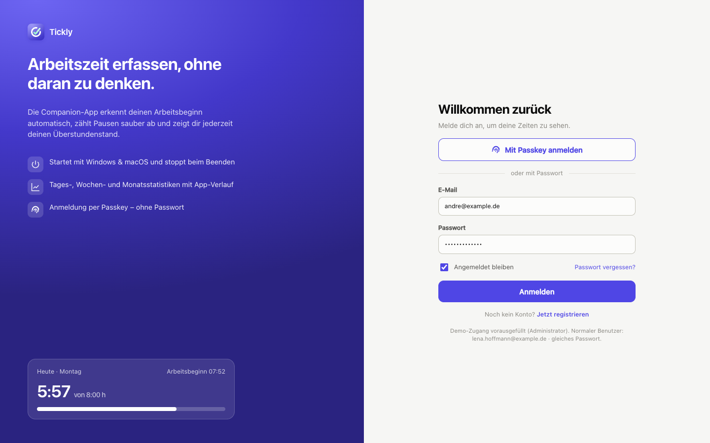
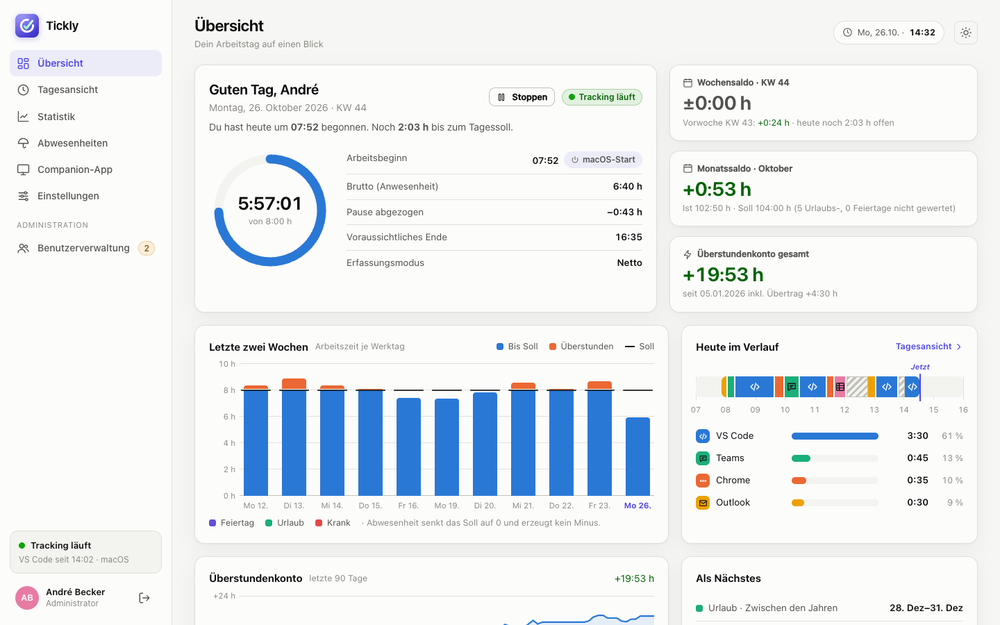
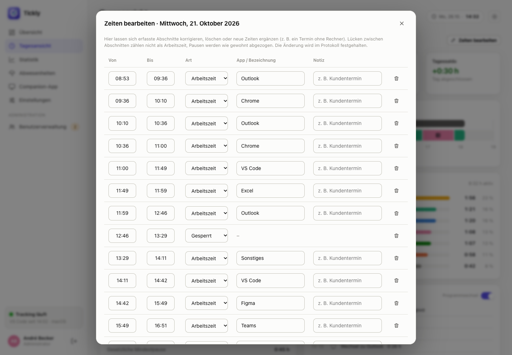
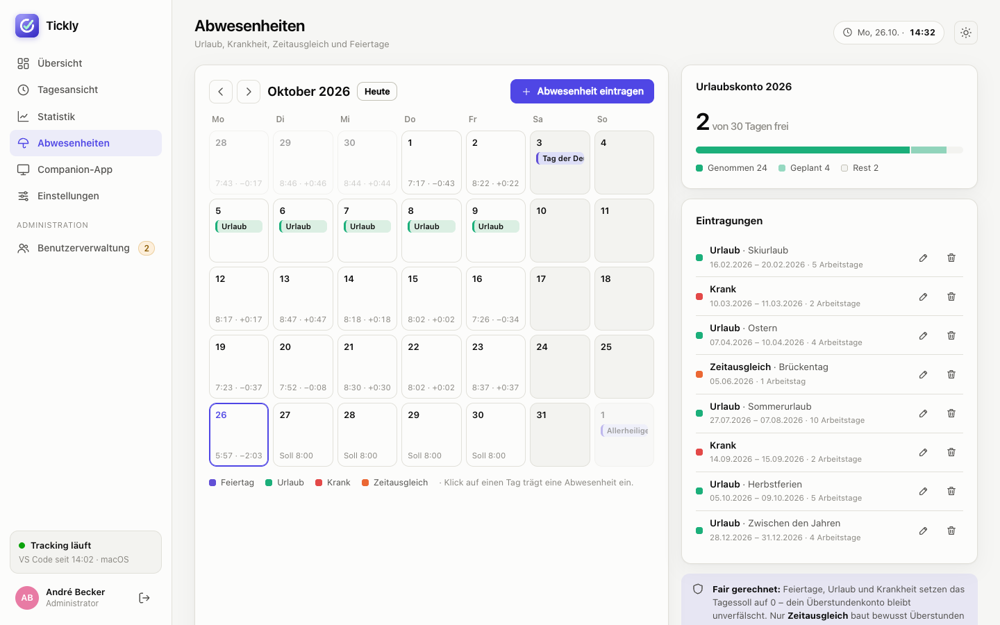
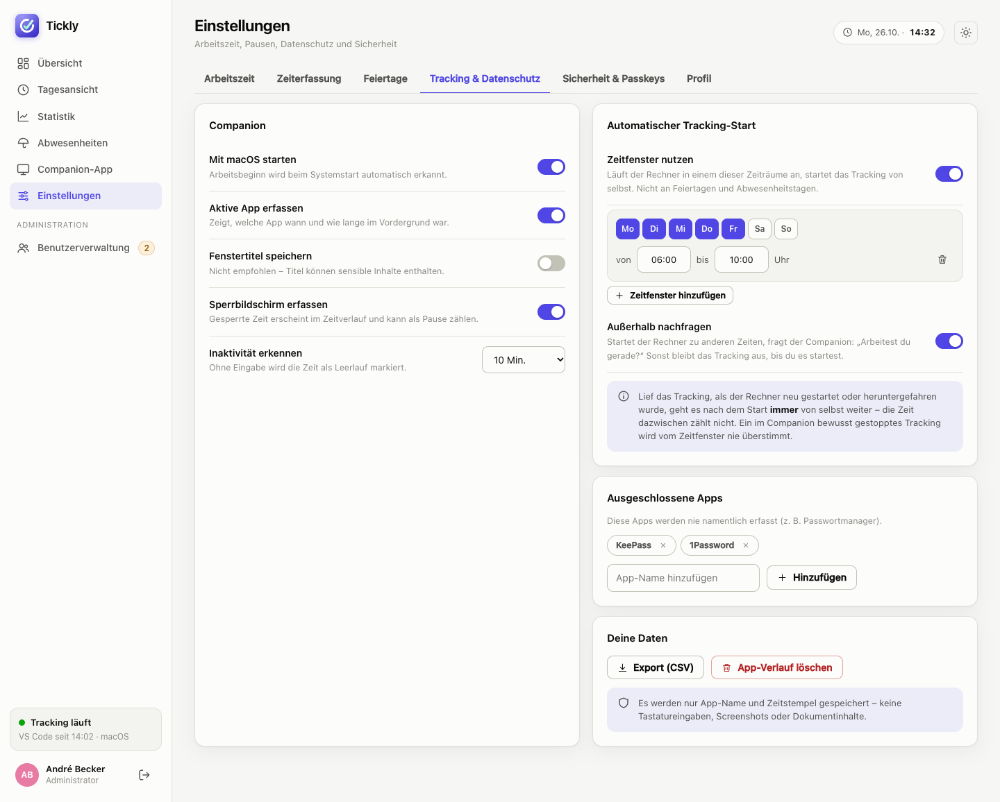
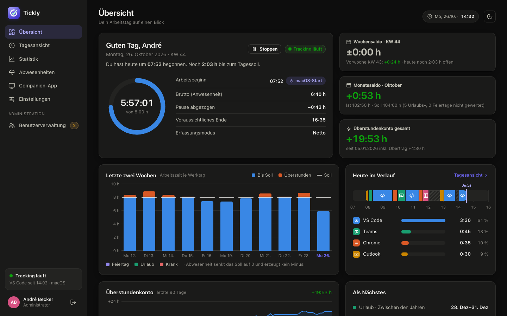

# Benutzerhandbuch

## Anmelden und Konto

- **Registrieren** (wenn der Administrator es erlaubt): Name, E-Mail, Passwort – und dein **Überstunden-Stand zu Beginn**: *Neu beginnen* (0 Stunden) oder ein **Übertrag** (z. B. `12,5` Guthaben oder `−3` Minusstunden). Danach nur noch durch einen Administrator änderbar. Je nach Einstellung musst du deine **E-Mail-Adresse bestätigen** (Link in der Mail) und auf die **Freigabe** warten.
- **Anmelden** mit Passkey (Fingerabdruck, Gesicht, PIN, Sicherheitsschlüssel) oder Passwort. Mit eingerichteter Authenticator-App folgt nach dem Passwort ein Code.
- **Passwort vergessen?** → Link per E-Mail (nur wenn der Server E-Mail versenden kann).
- Unter **Einstellungen → Sicherheit & Passkeys** richtest du Passkeys und die **Authenticator-App** ein, siehst deine angemeldeten Geräte (und meldest sie ab) und änderst dein Passwort. Verlangt der Administrator einen dieser Faktoren, erinnert dich ein Hinweis; nach Ablauf der Frist geht nichts anderes mehr.

## Übersicht

- **Ring:** Heute gezählte Arbeitszeit (mit Sekunden) im Verhältnis zum Tagessoll. Läuft sie, zählt die Anzeige mit.
- **Arbeitsbeginn, Brutto, Pause, voraussichtliches Ende:** Das Ende ergibt sich, wenn du ab jetzt durcharbeitest.
- **Wochen-/Monatssaldo, Überstundenkonto:** Feiertage, Urlaub und Krankheit senken das Soll auf 0 – sie erzeugen kein Minus. Zeitausgleich baut Überstunden bewusst ab.
- **Stoppen/Fortsetzen:** Hält die Zeiterfassung an (Pause zählt nicht). Beendet wird der Tag durch das Beenden des Companion.
- Der heutige Tag erzeugt erst Minus, wenn er beendet ist.

## Tagesansicht

- **Zeitverlauf:** oben Status (aktiv/gesperrt/aus), unten die aktive App. Beim Daraufzeigen: Dauer, Zeit, Notiz.
- **Ereignisse:** Start, Sperre, Pause, Beenden … Mit dem Schalter **Programmwechsel** blendest du jeden Wechsel der Anwendung ein.
- **Wie die Zeit berechnet wird:** Brutto, gesperrte Zeit, als Pause gewertet, gesetzliche Mindestpause, abgezogen, gezählte Arbeitszeit.
- Mit den Pfeilen oder dem Datumsfeld (`TT.MM.JJJJ`) wechselst du den Tag.

### Zeiten bearbeiten und ergänzen

**Zeiten bearbeiten** (bzw. **Zeit eintragen** an einem leeren Tag) öffnet die Abschnitte des Tages. Du kannst Von/Bis ändern, Abschnitte löschen und mit **Eintrag hinzufügen** Zeit ergänzen (z. B. einen Termin ohne Rechner; Bezeichnung „Manuell“ plus Notiz). Regeln:

- Abschnitte dürfen sich nicht überschneiden und nicht in der Zukunft liegen. Heute bleibt der **laufende** Abschnitt unverändert.
- Lücken zählen nicht als Arbeitszeit; Pausen werden wie gewohnt abgezogen.
- Der Administrator legt fest, wie viele Tage rückwirkend das erlaubt ist (Standard 90). Jede Änderung steht im Protokoll.

## Statistik

Woche, Monat, Jahr: Arbeitszeit, Soll, Saldo, Verteilung, Überstundenverlauf, CSV-Export. In der **Wochenansicht** steht je Tag die **Arbeitszeit ohne Pausen**, darunter die Pause, und unten die Wochensumme.

## Abwesenheiten

Urlaub, Krankheit, Zeitausgleich im Kalender eintragen. Wochenenden und Feiertage zählen nicht mit; der Resturlaub wird mitgeführt.

## Einstellungen

- **Arbeitszeit:** Tagessoll je Wochentag (mit Vorlagen), Brutto/Netto.
- **Zeiterfassung:** automatische Pausenregeln (z. B. ab 6 h 30 Min.), gesperrte Zeit als Pause werten, Mindestdauer.
- **Feiertage:** Bundesland und **weitere freie Tage** (Rosenmontag, Heiligabend, Silvester, eigene).
- **Tracking & Datenschutz:** automatischer Start nach **Zeitfenstern**, Rückfrage außerhalb, App-Erfassung, ausgeschlossene Apps, Export.
- **Profil:** Name, E-Mail, **Darstellung** (System/Hell/Dunkel).

### Wie Zeitfenster und Rückfrage zusammenspielen

- Startet der Rechner **in einem Zeitfenster** (nicht an Feiertagen/Urlaub), beginnt das Tracking von selbst.
- Sonst fragt der Companion **„Arbeitest du gerade?“**. *Ja, starten* beginnt jetzt, *ab Rechnerstart* rechnet rückwirkend, *Nein* lässt es aus – bis das nächste Zeitfenster beginnt.
- Ein bewusstes **Stoppen** wird nie von einem Zeitfenster überstimmt.
- Lief das Tracking beim Herunterfahren/Neustart, geht es danach immer weiter.

## Dunkelmodus

*Einstellungen → Profil → Darstellung* oder das Symbol oben rechts (System → Hell → Dunkel). „System“ folgt dem Betriebssystem, auch während der Laufzeit.

