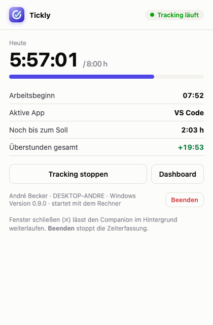

# Companion-App

Die Companion-App läuft auf dem Arbeitsrechner (Windows 10/11, macOS 13+) im Hintergrund, erkennt Arbeitsbeginn, Sperre, Programmwechsel und Beenden und meldet sie dem Server. Sie braucht keine Bedienung im Alltag.

## Installieren

Die Installer stehen bei den **Release-Dateien** des Projekts (GitHub → *Releases*):

| System | Datei |
|---|---|
| Windows | `Tickly.Companion_<Version>_x64-setup.exe` (bis 0.9.3 zusätzlich als `.msi`) |
| macOS | `Tickly.Companion_<Version>_universal.dmg` (Apple Silicon und Intel) |

**Hinweis zu unsignierten Installern:** Die Installer sind nicht signiert. Prüfe vorher die Prüfsumme (`SHA256SUMS` aus dem Release: `shasum -a 256 <Datei>` auf dem Mac, `certutil -hashfile <Datei> SHA256` unter Windows).

- **Windows:** *SmartScreen* („Der Computer wurde durch Windows geschützt“) → *Weitere Informationen* → *Trotzdem ausführen*.
- **macOS:** Beim Start kommt „Tickly Companion nicht geöffnet – Apple konnte nicht überprüfen, ob … frei von Schadsoftware ist“. **Nicht** „In den Papierkorb legen“ wählen, sondern *Fertig*. Dann:
  1. Die App aus dem DMG in den Ordner *Programme* ziehen.
  2. Entweder *Systemeinstellungen → Datenschutz & Sicherheit*, nach unten blättern, bei „Tickly Companion wurde blockiert“ auf **Trotzdem öffnen** klicken (erscheint erst nach dem ersten Startversuch) und mit Passwort bestätigen,
  3. oder im Terminal die Sperre für diese App aufheben: `xattr -dr com.apple.quarantine "/Applications/Tickly Companion.app"` und die App dann normal starten.

  Das „Rechtsklick → Öffnen“ aus älteren macOS-Versionen funktioniert in neueren nicht mehr.

Mit einer Apple-Developer-ID und Notarisierung entfällt das (siehe [Entwicklung](ENTWICKLUNG.md)).

macOS braucht **keine** Zusatzrechte (weder „Bedienungshilfen“ noch „Bildschirmaufnahme“): Der Name der aktiven App und der Sperrzustand sind ohne sie lesbar.

## Koppeln

1. In der Weboberfläche: **Companion-App → Kopplungscode erzeugen** (gilt 10 Minuten, einmal verwendbar).
2. Companion starten, **Server-Adresse** (z. B. `zeit.example.com`) und **Code** eingeben → *Koppeln*.

Das Gerät erhält ein eigenes Token (im **macOS-Schlüsselbund** bzw. in der **Windows-Anmeldeinformationsverwaltung**). In der Weboberfläche und von Administratoren lässt sich die Kopplung jederzeit aufheben.

Unbeaufsichtigte Einrichtung (z. B. per Skript): Umgebungsvariable `TICKLY_PAIR="zeit.example.com|ABCD-EFGH"` beim ersten Start.

## Verhalten

| Situation | Was passiert |
|---|---|
| Rechner startet | Companion startet mit (einstellbar), meldet den Start. Im Zeitfenster beginnt das Tracking von selbst, sonst fragt er: **„Arbeitest du gerade?“** |
| Fenster schließen (✕) | Nur ausblenden, der Companion läuft weiter im Infobereich bzw. in der Menüleiste. |
| **Beenden** (Tray-Menü, Cmd+Q) | Tracking stoppt, das **Arbeitsende** wird gesetzt. |
| Neustart/Herunterfahren während Tracking | Wird gemeldet; nach dem nächsten Start läuft das Tracking **von selbst weiter** (die Zeit dazwischen zählt nicht). |
| Absturz, Stromausfall | Die Erfassung endet beim letzten Lebenszeichen (alle 30 s); beim nächsten Start geht es weiter. |
| Bildschirm gesperrt, Ruhezustand | Wird als gesperrt erfasst (zählt als Pause, wenn länger als die eingestellte Mindestdauer). |
| **Stoppen** im Fenster/Tray | Pause, der Tag bleibt offen, die Pause zählt nicht. Fortsetzen mit einem Klick. |
| Keine Verbindung | Alles läuft weiter, die Ereignisse werden gespeichert und später übertragen; das Überstundenkonto ist dann geschätzt. |

Aktive App: Es wird nur der **Programmname** erfasst. Apps aus der Liste „Ausgeschlossene Apps“ (z. B. Passwortmanager) werden als „Sonstiges“ gemeldet. Fenstertitel werden nie gelesen oder gesendet.

Einstellungen (Zeitfenster, Autostart, ausgeschlossene Apps, Pausenregeln) nimmst du in der **Weboberfläche** vor; der Companion übernimmt sie automatisch.

## Daten auf dem Rechner

| Was | Wo |
|---|---|
| Kopplung, Warteschlange, lokaler Tagesstand | macOS: `~/Library/Application Support/de.tickly.companion/` · Windows: `%APPDATA%\de.tickly.companion\` |
| Token | Schlüsselbund bzw. Anmeldeinformationsverwaltung (nur wenn nicht verfügbar: Datei `device.token`, nur für den Benutzer lesbar) |

## Deinstallieren

Companion beenden, App löschen (macOS: aus *Programme* in den Papierkorb; Windows: *Apps & Features*). Optional den Datenordner löschen und in der Weboberfläche die Kopplung aufheben. Wurde der Autostart eingerichtet, entfernt die App ihn nicht automatisch: macOS *Systemeinstellungen → Allgemein → Anmeldeobjekte*, Windows *Task-Manager → Autostart*.

## Fehlersuche

| Problem | Hinweis |
|---|---|
| „Der Code ist ungültig oder abgelaufen“ | Neuen Code erzeugen; er gilt 10 Minuten und einmal. Nach mehreren Fehlversuchen sperrt der Server die Adresse vorübergehend. |
| „Server nicht erreichbar“ | Adresse prüfen (HTTPS). Die App versucht es weiter und sendet später nach. |
| „Kopplung aufgehoben“ | Gerät wurde in der Weboberfläche getrennt → in der App *Neu koppeln*. |
| Statt Programmen steht „Sonstiges“ | Nur die sechs häufigsten Programme der letzten 90 Tage bekommen eine eigene Farbe; der Rest läuft unter „Sonstiges“, ist aber in der Tagesansicht beim Daraufzeigen benannt. |
| Zeiten fehlen nach Absturz | Siehe Tabelle: Die Erfassung endet beim letzten Lebenszeichen. Fehlende Zeit lässt sich unter *Tagesansicht → Zeiten bearbeiten* ergänzen. |

> **Windows:** Aktive-App-Erkennung, Sperrerkennung und die Meldung beim Herunterfahren sind für Windows geschrieben, aber noch nicht auf einem echten Windows-Rechner geprüft. Falls etwas nicht stimmt, bitte melden (Windows-Version, Verhalten).
